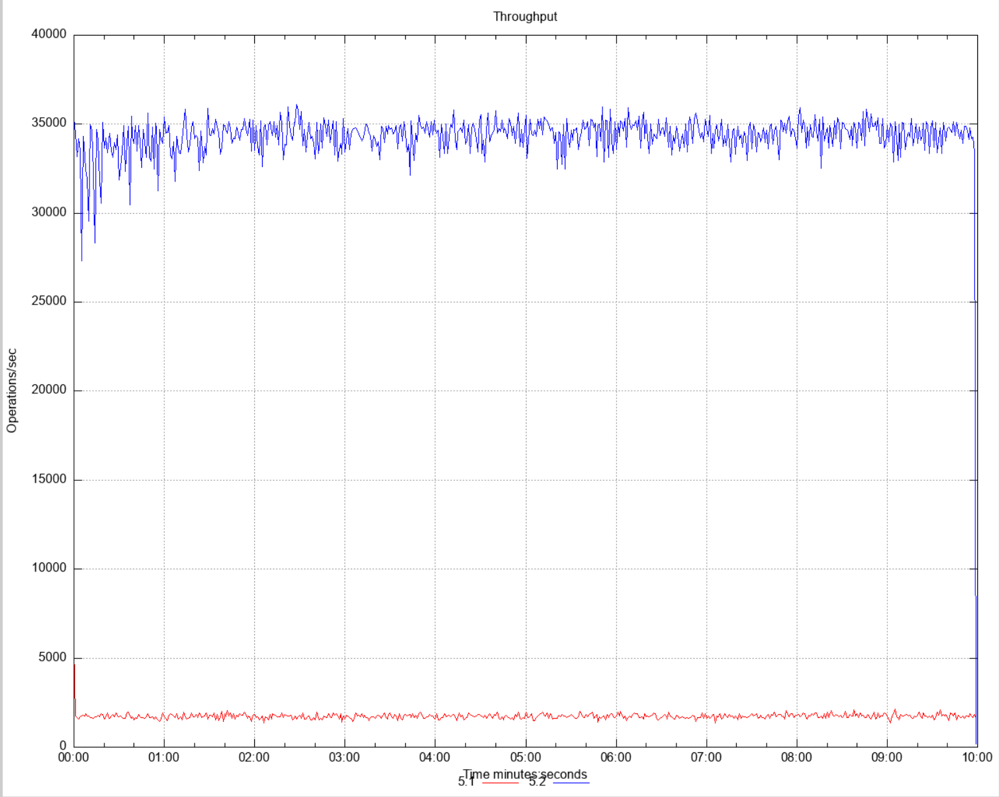
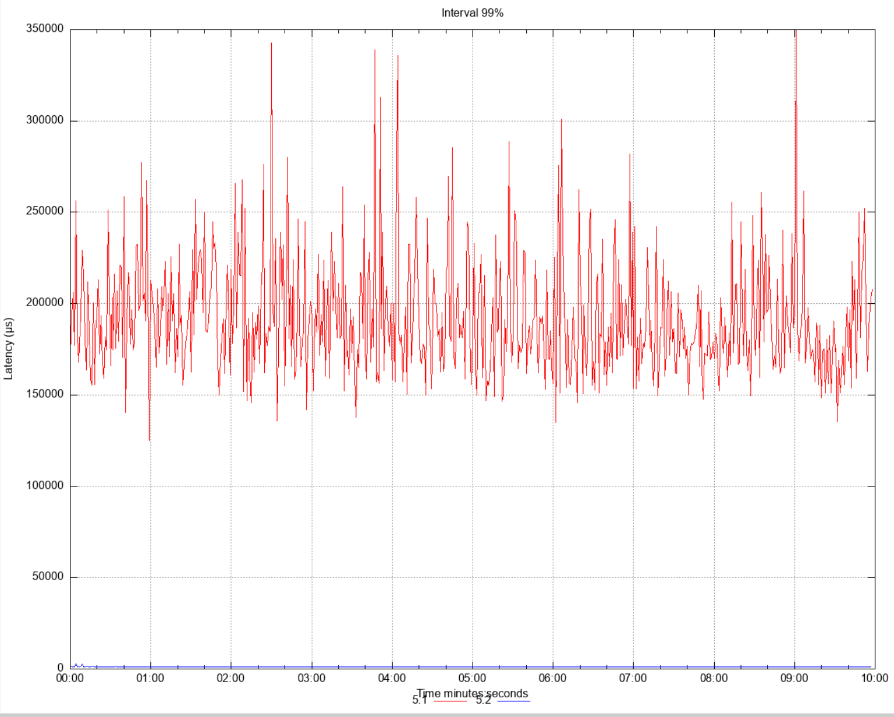

# Offloading MapStore MapLoader Operations

| ℹ️ Since: 5.2 |
|---------------|

## Summary
Blocked partition threads limits the throughput of cluster.
By implementing MapStore MapLoader operation offloading,
next operations will not be blocked in a partition.

## Goals
- Having MapStore and MapLoader operations offloaded for IMap

## Non-Goals
- Changes in cluster wide map bulk loading mechanism.
- JCache CacheLoader and CacheWriter are out of scope.

## Description
In its essence this is a [Head-of-line
blocking](https://en.wikipedia.org/wiki/Head-of-line_blocking) issue.
One MapStore operation can block other operations from completing by
blocking partition threads. Since partition threads are one of the
most important shared resources in a cluster, an execution in these
threads must be fast so next executions can complete fast as well.

Example potentially problematic cases to be addressed here:
- After a cache miss, loading a value from MapStore  
- Bulk loading and storing with loadAll/storeAll methods
- When DB is down cluster is hanging

### Design

#### Overall View
When MapStore interaction is needed, interaction is executed
asynchronously and the partition thread is freed. Once
the interaction completes, the task/operation is rescheduled on
the original partition thread and completes. So all the other 
logic that updates the internals remains same.

#### Implementation
We divide MapStore interaction needed operations into parts which can be executed separately.
These self executable parts are called `Step`:
```java
interface Step {

    void runStep(State state);

    Step nextStep(State state);

    boolean isOffloadStep();
}
```
In its essence, a step is either an instance of a `PartitionSpecificRunnable` or a `Runnable`.

And we model an operation as a sequence of `Step`s.

#### Example Model for IMap#get
For instance, sequence of get operation steps are: `READ`,`LOAD`,`ON_LOAD`,`RESPONSE`,`AFTER_RUN`. 

`READ` step tries to read value in partition thread and if it finds no matching
value in memory, `LOAD` step starts value loading from MapStore in a separate offloaded thread. 
Upon `LOAD` finishes, execution is restarted in partition thread again from the step `ON_LOAD`.

If no loading from MapStore is required, all steps are
executed in partition thread and no offloading is done.

`State` is used to pass state between `Step`s.


#### Flow in Partition Thread

                      ------------------------------
                      Operation starts its execution
                      ------------------------------
                                  |
                                  |
          ------------------------------------------------------
            Check if the operation needs mapstore interaction?  ---> If No --> Do regular execution
          ------------------------------------------------------               in partition thread
                                  | 
                                  | If Yes
                                  |   
          ------------------------------------------------------
            Put associated Step in offloaded MapStore
            operations queue.
          ------------------------------------------------------
                                  | 
                                  |
          -------------------------------------------------------
          Start running Step chain of this operation and execute  <---
          Steps which can be executed here without needing offload.   |
          --------------------------------------------------------      |
                                  |                                     | 
                                  |                                     |
                                  |                                     |
          ----------------------------------------------------    If No |
                  Do we encounter offload needed Step?      ---------->
          ----------------------------------------------------
                                  | 
                                  | If Yes
                                  |
          -------------------------------------------------------
                  Offload next Step and free partition thread
          -------------------------------------------------------
                                  | 
                                  |
                          --------------------
                            End of execution
                          --------------------


#### Flow in Offloaded Thread
          -------------------------------------------------------
            Run offload needed Step of this operation here         <---
          --------------------------------------------------------      |
                                  |                                     | 
                                  |                                     |
          ----------------------------------------------------   If Yes |
                  Do we encounter offload needed Step?      ---------->
          ----------------------------------------------------
                                  | 
                                  | If No
                                  |
          -------------------------------------------------------
              Schedule next Step to run in partition thread
          -------------------------------------------------------
                                  | 
                                  |
                          --------------------
                            End of execution
                          --------------------

### Risks and Assumptions

All MapStore interacting operations are queued per map per partition and
next operations must wait finish of head operation before execution,
although this is an improvement when we compare it with the current
situation(which is all operations of all maps in a partition waiting
head operation), it is also a limitation to preserve current behavior.


### Performance Test Results
Comparison of 5.1 and 5.2-with-the-implementation-here.
#### Test
- Goal is to see the behavior of unblocked partition threads
- 2 maps, do get and put
- One map has slow MapStore(variant latency between 1-100 millis) and only does put
- Second map is default map without a MapStore

|            Throughput             |                          Latency                          |
|:---------------------------------:|:---------------------------------------------------------:|
|  |                             ||

 


